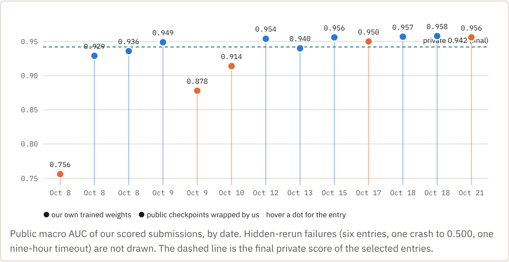
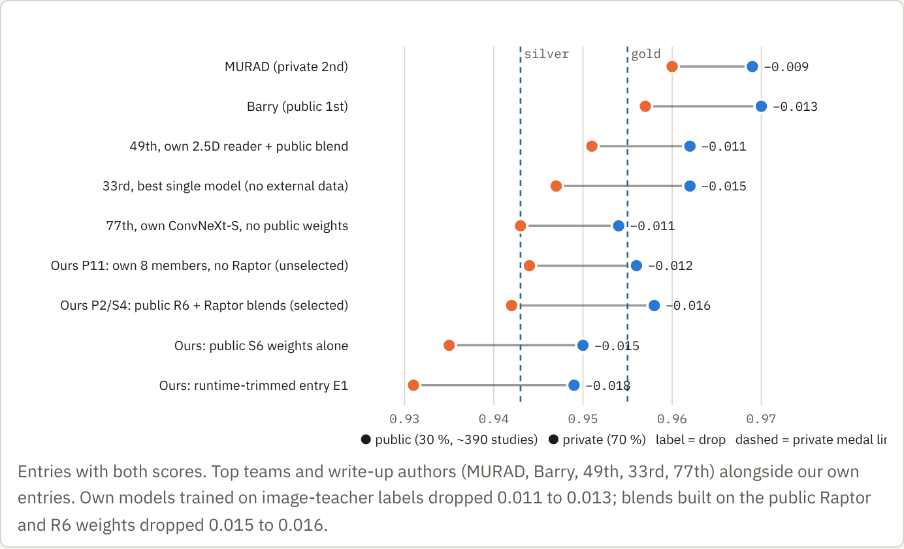
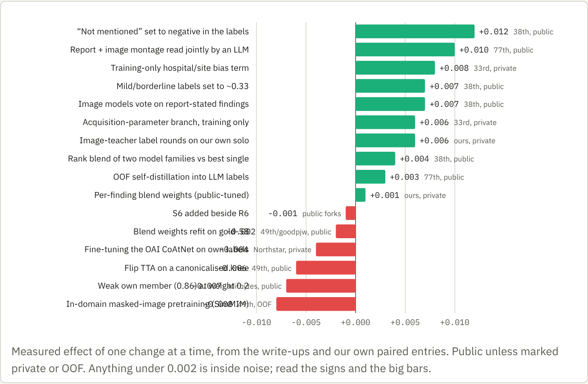
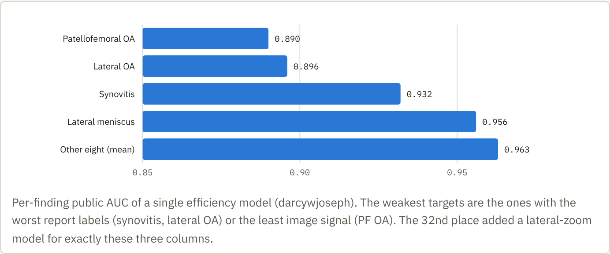

<!-- Markdown rendering of competition-review-20261023.html (the HTML is the source; figures are rendered from it). -->
*RSNA Knee Abnormality Detection · Kaggle · closed 22 Oct 2026 · written 23 Oct, revised with 12 write-ups*

# We finished at 0.942. Here is what the competition taught us.

Twelve findings per knee MRI study, scored by macro ROC AUC, 4,407 training studies with free-text reports in nine languages and only 58 expert-labelled studies. Our two selected entries both scored **0.958 public** and **0.942 private**, rank 715 of 6,425. An entry we did not select, our own eight models with no public Raptor weights, scored **0.944 private**, which was silver. The competition was decided by label quality and by a hospital shortcut nobody saw at first, not by backbones.

| | |
|---|---|
| **0.942** | both selected entries · rank 715 / 6,425 |
| **0.944** | our best private entry (P11, unselected) · silver band |
| **0.960** | private winner · gold line ≈ 0.955 (rank 22) |
| **0.943** | silver line (rank 321) · bronze (rank 642) inside the 0.942 tie |

## 1. Our campaign in one picture

*Public macro AUC of our scored submissions, by date. Hidden-rerun failures (six entries, one crash to 0.500, one nine-hour timeout) are not drawn. The dashed line is the final private score of the selected entries.*

- **Our own trained weights topped out at 0.914** until the last week, when image-teacher relabelling (labels v3 to v5) lifted our own compact models to 0.955 to 0.956 public and 0.942 to 0.944 private. Everything above 0.950 before that was public checkpoints we wrapped, qualified and reweighted.
- **The selection rule, not the models, cost the medal.** We pre-registered "highest public display, ties to the own-heavy entry". It picked the public fork P2 and a Raptor blend S4, the same bet twice. Gold-58 had ranked the Raptor half last, and that was right on the private board.
- **Operational losses were large.** Six hidden reruns failed with no score, one entry crashed to the constant fallback, one timed out at nine hours. Each cost a day of the five-per-day slot budget and a lot of verification work.

## 2. The shake-up was a shift, with a family-dependent slope

*Entries with both scores. Top teams and write-up authors (MURAD, Barry, 49th, 33rd, 77th) alongside our own entries. Own models trained on image-teacher labels dropped 0.011 to 0.013; blends built on the public Raptor and R6 weights dropped 0.015 to 0.016.*

- **Public rank was never a measurement.** The public split is about 390 studies with a macro standard error near 0.003. At the deadline 1,638 teams displayed 0.958; on the private board 1,322 teams display 0.942 (ranks 616 to 1,937) and the bronze cut sits inside that tie.
- **The public recipe lost 0.005 more than own models.** Its per-finding weights and probe switches were tuned on the public board by their authors. The private split was also harder on synovitis (0.914 to 0.860 for one team) and contusion, and easier on lateral OA.
- **Gains confirmed offline held; gains found only on the public board did not.** Our image-teacher labels moved the own solo by +0.005 public and +0.006 private. Raptor over our own members was +0.002 public and −0.002 private.

## 3. What the medal teams did

> The top-three write-ups are not published yet (winners have until November 5). This section is built from the posts of places 32, 33, 38, 49, 73, 74, 77, 102, 220, 228, 243 and 671, all read on October 23. Links in the sources.

- **Labels were read like a clinician and against the rubric.** The 38th place team classified every report finding as meets threshold / below threshold / negative / not mentioned, then re-levelled each group to the expert-positive rate on gold-58 (not mentioned 6 %, mild 33 %, positive below rubric 71 %, meets rubric 85 %). Label AUC against gold went from 0.902 to 0.947, and "not mentioned means negative" alone was worth +0.012 on the board.
- **Multimodal LLMs read the images.** A report-only LLM saturates near 0.90 against the experts. Reading report plus slice montage together reached 0.932 (77th), a two-model hybrid mosaic read 0.928 (243rd, Chris Deotte), and blind image reads merged with text 0.935 on the same model (65th). GPT-6 Astra blind-read effusion at 0.98 AUC. Mixing out-of-fold image predictions back in took labels to 0.945.
- **The hospital is a variable.** Acquisition parameters predict report language with 98 % accuracy, and each site reports synovitis or PF OA at very different rates. The 33rd and 38th place teams added a site × finding bias term used only during training and dropped at inference. It was their largest single gain (+0.006 public for 38th, +0.009 to +0.015 private across four pairs for 33rd). The 228th place got +0.003 by subtracting a metadata-only prior after the blend.
- **Architecture: all series, all slices, attention per finding.** The 33rd place used feature-map cells (~12 mm) as MIL instances with a 3D rotary attention across series, single model 0.947 private with no external data. The 49th used a slice-bag transformer with twelve finding queries. The 32nd added an evidence loss pulling attention toward the slices the VLM cited. Backbones were ConvNeXt-S/T, CoAtNet, EfficientNetV2-S; a partially fine-tuned OrthoFoundation-L ViT scored the same as CoAtNet at four times the compute.
- **Anatomy-anchored crops beat centre crops.** The 30th place trained a YOLO knee-ROI detector on boxes drawn by Claude Code subagents under millimetre rules; the ROI crop mattered more than any model change. The 38th and 74th used landmark-anchored compartment crops as a second leg.
- **External knee data worked only as pretraining or as a careful vote.** OAI-pretrained Raptor arms were +0.012 private over a clean track (671st); 2,399 OAI knees with MOAKS labels helped in a 50/50 average (32nd). Naive OAI mixing cost 0.012 (solo write-up), and fine-tuning the OAI CoAtNet on own labels cost 0.004.
- **Everyone measured their instruments.** Paired noise on gold-58 is about ±0.0125, seed noise on a fold about 0.0025. The 77th pre-committed acceptance gates and passed 3 of 32 experiments. The 49th read a single finding's public AUC by resubmitting with one column inverted: AUC = 0.5 + 6 × (base − probe).

## 4. What worked and what did not

*Measured effect of one change at a time, from the write-ups and our own paired entries. Public unless marked private or OOF. Anything under 0.002 is inside noise; read the signs and the big bars.*

### Worked

- **Label work against the rubric**: four-state report classes re-levelled to expert rates, silence treated as a low non-zero probability, mild as one-in-three, image models voting on what the report states, then two to four image-teacher rounds. The 49th: of 0.019 gained by a five-fold ensemble, 0.013 came from label rounds.
- **Training-only site bias** or a post-hoc metadata de-bias, to stop the image model learning "which hospital is this".
- **2.5D attention MIL over every slice of every series** at 320 to 384 px over a 130 to 140 mm field, three-slice windows, per-finding attention or queries, knees mirrored to one side.
- **Rank blends of two or three model families** with label-lineage diversity. Label diversity beat seed diversity everywhere; a new member needed to be within a few points of the stack and decorrelated.
- **Fail-soft inference**: per-member timeouts, weights renormalised over surviving legs, offline decoders for 13 DICOM transfer syntaxes. Fixing 1 to 13 hidden studies that fell back to a prior was worth +0.001.

### Did not work

- **Frozen foundation features.** Our frozen DINOv2 head scored 0.756; frozen DINOv3-H+ ceilinged at 0.826 OOF for the 49th; DINOv3 at the wrong learning rate lost 0.03. Only partial fine-tuning of a knee-pretrained ViT-L matched a CNN.
- **Bigger inputs, backbones, schedules:** 448 px, Small vs Tiny, SWA, EMA, longer training, more seeds, stacking, 3D through-plane branches, SimMIM pretraining (−0.008). All level or worse once labels were good.
- **Flip TTA on canonicalised knees** (−0.006) because it swaps medial and lateral. Learned spatial attention was average pooling in disguise for the 77th.
- **Using gold-58 as a target:** as training rows, as few-shot examples in the labelling prompt (0.947 vs 0.951), or to fit blend weights. Every team that tried it lost.
- **Agentic LLM readers with tools** did not beat a plain multimodal prompt (77th), though a purpose-built viewer with crop, window and measure tools produced auditable labels (73rd). Rule-based relabelling from report wording cost 0.020 (74th).

*Per-finding public AUC of a single efficiency model (darcywjoseph). The weakest targets are the ones with the worst report labels (synovitis, lateral OA) or the least image signal (PF OA). The 32nd place added a lateral-zoom model for exactly these three columns.*

## 5. What we got wrong

- **We picked a public fork as a final.** With 1,400 copies tied, P2 could only land where the block landed. S4 held nearly the same bet. P11, our own members alone, was the obvious hedge and would have been silver.
- **We ranked finals by public score inside the noise band.** The pre-registered rule was right to exist and wrong in its criterion. Gold-58 and out-of-fold both put our members at R6 level and Raptor last; we trusted a +0.002 public difference instead.
- **We built an auditing machine, not a model, for the first three weeks.** Qualification gates, receipts, waivers and a 4,000-line handoff log consumed most of two agents' time. The relabelling that finally moved our own models came in the last five days.
- **We spent the gold set early.** Ten label variants were selected on gold-58, after which nothing could be validated there. Everyone who medalled used it as a hands-off sanity check.
- **We never looked for the site shortcut.** We had the DICOM headers and the language column. Two teams found +0.006 to +0.015 there with a bias term that costs nothing at inference.
- **Inference fragility cost scored slots.** Hidden reruns failed where the visible three studies passed. The ledger-salvage fix that finally held should have been there on day one.

## 6. Research perspective: knee MRI detection

- **The field's recipe since MRNet (2018) still holds, upgraded.** Per-slice 2D encoder, pooling across slices and planes. The 2026 version swaps AlexNet for ConvNeXt or CoAtNet, max pooling for attention MIL (Ilse et al. 2018) with one query per finding, and adds geometry: feature cells with 3D patient coordinates and rotary attention across series (33rd), or a 3D splat grid around the joint centre (73rd). No pure 3D network placed.
- **Weak supervision from reports is a label-noise and label-shift problem.** Report wording does not match an expert rubric, silence is informative, and reporting habits vary by site. The winning pattern is LLM extraction with rubric-level classes, calibration to a small expert set, self-training with image-derived pseudo-labels, and a debiasing term for the site. This is product-of-experts debiasing applied to medical weak labels.
- **Multimodal LLMs are now usable radiology readers for labelling.** Blind image reads reached 0.98 AUC on effusion and 0.96 on lateral OA against experts (65th), and a coding agent drew usable anatomical bounding boxes under millimetre rules (30th). Pathology boxes for small structures still failed.
- **Knee-specific pretraining matters more than scale.** OAI pretraining was worth +0.012 private. A DINOv3 ViT-L further trained on knee images matched a CoAtNet only after fine-tuning eight blocks; frozen or generically pretrained ViTs lost. SimMIM in-domain pretraining hurt.
- **Macro AUC rewards fixing the worst three findings.** PF OA, lateral OA and synovitis sat 0.03 to 0.07 below the rest. The gains there came from lateral-zoom models, the synovitis composite (effusion plus OA) and site debiasing, not from backbones.
- **Licensing shaped the field.** OAI needs registration; the host ruled registration plus licence acknowledgement acceptable, institutional agreements not. Several strong teams stayed clean and still reached 0.947 to 0.952 private.

## 7. Checklist for the next competition

- Week 1: a reliable offline inference harness with per-member timeouts, salvage of finished members, and a hidden-size timing run. Audit hidden studies that fall back to a prior.
- Week 1: measure every instrument's noise (public split SE, expert-set paired SD, seed SD) and write acceptance rules before each experiment.
- Read the labels like a clinician: rubric-level classes, silence as low non-zero, calibration to the expert set, then image-teacher rounds. Read images with a multimodal model early, blind of the report.
- Check for site, scanner and language shortcuts in the first week. Add a training-only bias term when they exist.
- Hold the expert set for hands-off checks. Select on scanner-grouped out-of-fold folds.
- Reproduce the public lineage once, then put all GPU into one strong, decorrelated member of our own.
- Never pick a public fork as a final. Pick 1 is the best entry on trusted validation; pick 2 differs from pick 1 and from the crowd.
- Keep one experiment log and one state file. Every verification minute is a minute not spent training.

## Sources

- Ours: [docs/research/retrospective-20261023.md](https://github.com/ozgung/rsna-knee-abnormality-detection/blob/main/docs/research/retrospective-20261023.md) (final selection, per-family shake-up), STATUS.md, docs/archive/handoff/claude-astra-handoff.md, docs/research/strategy-revision-20261017.md, docs/experiments/campaign-overview-20261013.md.
- Write-ups: [32nd (zosamu)](https://www.kaggle.com/competitions/rsna-knee-abnormality-detection/discussion/751930) · [33rd (hirokenn)](https://www.kaggle.com/competitions/rsna-knee-abnormality-detection/writeups/33rd-place-silver-solution-no-external-data) · [38th (The Hospital Is a Variable Too)](https://www.kaggle.com/competitions/rsna-knee-abnormality-detection/writeups/the-hospital-is-a-variable-too) and [38th summary](https://www.kaggle.com/competitions/rsna-knee-abnormality-detection/discussion/751924) · [49th (Komil Parmar)](https://www.kaggle.com/competitions/rsna-knee-abnormality-detection/writeups/49th-place-silver-solo-whole-study-2-5d-reader) · [30th ROI boxes (YYama)](https://www.kaggle.com/competitions/rsna-knee-abnormality-detection/discussion/751903) · [65th labels (tingyi)](https://www.kaggle.com/competitions/rsna-knee-abnormality-detection/discussion/751920) · [73rd KneeSplatNet](https://www.kaggle.com/competitions/rsna-knee-abnormality-detection/writeups/kneesplatnet) · [74th](https://www.kaggle.com/competitions/rsna-knee-abnormality-detection/writeups/74th-place-knee-centred-views-llm-labels-and-oa) · [77th (Civitasmass)](https://www.kaggle.com/competitions/rsna-knee-abnormality-detection/writeups/multimodal-llm-relabeling-oof-self-distillation) · [102nd](https://www.kaggle.com/competitions/rsna-knee-abnormality-detection/writeups/102nd-place-local-llm-report-labeling-and-anatomy) · [220th](https://www.kaggle.com/competitions/rsna-knee-abnormality-detection/writeups/220th-place-silver-gold-batch-fine-tuning-on-to) · [228th](https://www.kaggle.com/competitions/rsna-knee-abnormality-detection/writeups/228-solo-silver-subtract-the-report-style-prior) · [243rd (Chris Deotte)](https://www.kaggle.com/competitions/rsna-knee-abnormality-detection/writeups/243rd-silver-medal) · [507th](https://www.kaggle.com/competitions/rsna-knee-abnormality-detection/discussion/751949) · [671st (Northstar, same scores as ours)](https://www.kaggle.com/competitions/rsna-knee-abnormality-detection/writeups/public-0-958-private-0-942-what-65-submissions).
- GitHub write-ups: [TranBaDat2607](https://github.com/TranBaDat2607/RSNA-Knee-Abnormality-Detection) (private 0.943, clean track 0.931), [darcywjoseph](https://github.com/darcywjoseph/Knee-Abnormality-Detection/blob/main/SOLUTION.md) (per-finding AUCs, efficiency entry), [ppx16](https://github.com/ppx16/rsna-knee-record), [aditbytes](https://github.com/aditbytes/kaggle-rsna-knee-abnormality).
- Public lineage: [goodpjw2008 R6 + Raptor](https://www.kaggle.com/code/goodpjw2008/rsna-knee-coatnet-r6-2-5d-mil-lb-0-958), [heliosli blend](https://www.kaggle.com/code/heliosli/blend-mine-in-private-lb-luck-to-all-upvoters), [nartaa S6](https://www.kaggle.com/code/nartaa/rsna-knee-s6fall-solo), [final leaderboard](https://www.kaggle.com/competitions/rsna-knee-abnormality-detection/leaderboard).
