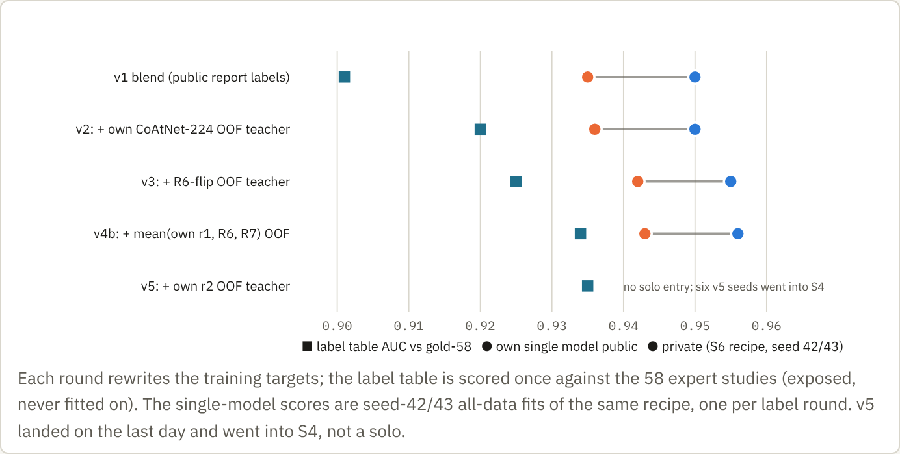
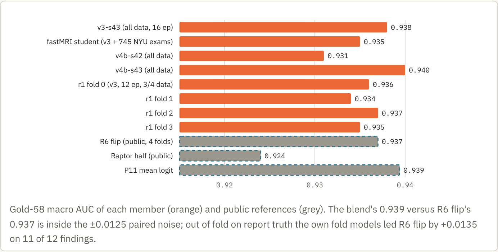

<!-- Markdown rendering of own-solution-p11-20261023.html (the HTML is the source; figures are rendered from it). -->
*RSNA Knee Abnormality Detection · submission 57471109 (P11) · Oct 21 2026 · unselected*

# Our best entry was the one with none of the public weights in it.

P11 is the mean of eight ConvNeXt-small readers we trained ourselves in the last four days, on labels rewritten by image teachers. It scored **0.956 public** and **0.944 private**. We did not select it. It would have been silver (the 0.944 block ends at rank 311). This is the write-up we would have posted.

| | |
|---|---|
| **0.944** | private · public 0.956 · drop 0.012 |
| **8** | own ConvNeXt-S members, mean logit, no Raptor, no R6 |
| **0.939** | gold-58 macro of the blend · R6 flip 0.937 |
| **5.5 h** | hidden wall on 2×T4, 0 fallback studies |

## 1. Summary

- **Model.** nartaa's public S6 recipe, unchanged: ConvNeXt-small (ImageNet-22k), 288 px crop from a 320 px cache, two views per slice (full field and a 100 mm knee-centred crop placed by SKM-TEA anatomy anchors), three-slice windows 3.5 mm apart, per-finding spatial attention, 16 epochs on all 4,345 non-gold studies. Only the targets and the seed change between members.
- **Labels.** Three image-teacher rounds on top of the public report consensus: a public out-of-fold teacher (R6 flip), then a calibrated mean of our own out-of-fold fold models with R6 and R7, then our round-2 fold models alone. Label AUC against the 58 expert studies went 0.901 → 0.925 → 0.934 → 0.935, and the single-model private score followed, 0.936 → 0.942 → 0.943.
- **Ensemble.** Mean logit of eight members from the v3 and v4b label families, including four 12-epoch fold models and one student that also saw 745 fastMRI exams with soft targets. No public weights. No per-finding weights, no TTA, no stacking.
- **What decided it.** Labels. Seeds, resolution and blend weights were flat. Raptor, the OAI-pretrained CoAtNet everyone's 0.958 depended on, added +0.001 public and −0.002 private to this compact.

## 2. Labels: three rounds of image teachers

*Each round rewrites the training targets; the label table is scored once against the 58 expert studies (exposed, never fitted on). The single-model scores are seed-42/43 all-data fits of the same recipe, one per label round. v5 landed on the last day and went into S4, not a solo.*

- **Base.** A parameter-free mean of six public report-derived tables plus a Dread teacher column (`mean6_plus_dread`), built on the 4,349 non-gold studies only. Report-only consensus saturates at 0.90 against the experts, whatever the blend.
- **v3 (Oct 19).** Teacher = R6 flip run on its own held-out hash fold, so every study gets a prediction from a model that never trained on it. We confirmed the fold mapping first: in-fold AUC sits clearly above out-of-fold for every fold model. Target = base with the teacher mixed at weight 0.30 (MCL 0.15). Label AUC 0.925.
- **v4b (Oct 20).** Teacher = calibrated mean of three out-of-fold columns: our own four round-1 fold models (12 epochs each on labels v3), R6 flip and R7 plain. Weight 0.50 (MCL 0.25). Label AUC 0.934. A variant that let an LLM override the teacher toward the report text failed its gate (0.912) and was dropped.
- **v5 (Oct 21).** Same construction with the round-2 fold models (trained on v4b) as the only teacher. Label AUC 0.935; out of fold, round 2 beat round 1 by +0.003 [+0.002, +0.004] on 4,345 studies. The gain per round is shrinking, as every other team reported.
- **Rules we kept.** Gold-58 excluded from every fit and read once per artifact. Teachers only from held-out folds. Pre-registered kill rules per round (label AUC must beat the previous table; out-of-fold gain with CI above zero).

## 3. Members

*Gold-58 macro AUC of each member (orange) and public references (grey). The blend's 0.939 versus R6 flip's 0.937 is inside the ±0.0125 paired noise; out of fold on report truth the own fold models led R6 flip by +0.0135 on 11 of 12 findings.*

| Member | Labels | Data | Training | Gold-58 |
|---|---|---|---|---|
| v3-s43 | v3 | all 4,345 | 16 epochs, seed 43, 7.2 h A100 | 0.938 |
| fastMRI student | v3 + P2-teacher soft targets | 4,345 + 745 NYU fastMRI knee exams | 16 epochs, effective weight 0.5 on fastMRI rows | 0.935 |
| v4b-s42, v4b-s43 | v4b | all 4,345 | 16 epochs | 0.931, 0.940 |
| r1 folds 0–3 | v3 | 3/4 of the pool each, hash folds | 12 epochs | 0.934–0.937 |

- **Combination.** Per study and finding, the mean of the eight logits. We tested rank-mean and mean-probability on the 39-study rehearsal ledgers; the differences were below 0.001 and mean logit was the simplest to replay.
- **Why the fold models are in.** They are the teachers of v4b, trained on 75 % of the data, and individually within 0.005 of the all-data fits on gold. They add label-family diversity at no new training cost. Checkpoint averaging over the last three epochs was tested out of fold and was null.

## 4. Inference

- One notebook, 2×T4, offline. Each study is decoded once, rendered to the pinned 320 px cache layout, and every member runs on the same windows at stride 1 in its own worker. Sentinel studies are repeated across processes and boards before production (max |Δp| 0).
- Rehearsal on the frozen 39-study set projected 17,925 s; the hidden run took about 5.5 h. A deadline guard would have salvaged finished members before writing a constant file; it was not needed (0 fallback studies).
- CPU-only strict load of every checkpoint (hash, constructor state, two full forwards, repeat and unchanged-state checks) before the packet was sealed.

## 5. Evidence from paired entries

| Entry | Compact slot | Raptor half | Public | Private |
|---|---|---|---|---|
| V2 solo | one S6, labels v2 | none | 0.950 | 0.936 |
| C1 solo | one S6, labels v3 | none | 0.955 | 0.942 |
| v4b-s43 solo | one S6, labels v4b | none | 0.956 | 0.943 |
| **P11** | own 8, mean logit | none | 0.956 | **0.944** |
| P10p | own 8 | R384 | 0.957 | — |
| S4 (selected) | own 8 (v5 family) | R384 + R224 | 0.958 | 0.942 |
| P12 | ½ R6 plain + ½ own 8 | none | 0.950 | 0.936 |
| P2 (selected) | R6 flip | R384 + R224 | 0.958 | 0.942 |

- **Label rounds carried over to private in full** (+0.006 on the solo, +0.008 from V2 to P11). The public board showed the same ordering.
- **Raptor flattered the public split.** On gold-58 the Raptor half ranked last (0.924). Adding it to the own compact gave +0.002 public and −0.002 private. Everyone's 0.958 recipe lost 0.016; ours lost 0.012.
- **R6 plain beside our members hurt without Raptor** (P12, 0.936), so the public compact model was only ever useful as Raptor's partner.
- **Eight members equal one good member on the public board** (0.956 = 0.956) but gave +0.001 private over the best solo. Seeds are cheap insurance, not a lever.

## 6. What we would change

- **Start the label rounds on day two, not day fifteen.** The whole P11 line took four days of wall clock once the out-of-fold machinery existed. Three more rounds, a multimodal reader on the images, and rubric-level report classes were all within reach.
- **Add a training-only site bias.** Two silver teams got +0.006 to +0.015 from a hospital × finding offset dropped at inference. Our DICOM headers and the report-language column were already in the cache.
- **Train on every slice of every series.** The S6 recipe samples 64 windows from fixed slots; the 33rd and 49th place readers used all series and all slices with cell-level or query attention and reached 0.947 to 0.951 private as single models.
- **Select finals on trusted evidence, not the public tie.** Gold-58 and out-of-fold both said this entry was at least R6-class and Raptor was last. The pre-registered rule looked at the public display first and picked two Raptor blends.

## Reproducibility and sources

- Training code: nartaa's S6 `training_code/` (Apache-2.0) via `scripts/s6v2/vm_train.sh`, pinned trainer 12e430a3…; inference `compact_infer.py` 34f433fe…, anatomy checkpoint 5904dd16….
- Labels: `scripts/laneb/build_labels_v3.py`, Lane L4 `build_v4b.sh`; out-of-fold columns `scripts/laneb/vm_oof_infer.py` and Lane F round scripts. Tables and per-study columns are in ignored `outputs/` only.
- Repo notes: [retrospective](https://github.com/ozgung/rsna-knee-abnormality-detection/blob/main/docs/research/retrospective-20261023.md), [Lane B](https://github.com/ozgung/rsna-knee-abnormality-detection/blob/main/docs/experiments/lane-b-oof-20261019.md), [Lane C](https://github.com/ozgung/rsna-knee-abnormality-detection/blob/main/docs/experiments/lane-c-seeds-20261019.md), [Lane D](https://github.com/ozgung/rsna-knee-abnormality-detection/blob/main/docs/experiments/lane-d-fastmri-20261019.md), [labels v2](https://github.com/ozgung/rsna-knee-abnormality-detection/blob/main/docs/experiments/labels-v2-20261015.md), STATUS.md entries of Oct 20–22.
- Data terms: competition data under the RSNA agreement; fastMRI knee DICOM batch 2 under the NYU data-use agreement (student weights private); SKM-TEA anchors via heliosli's public checkpoint. No OAI-derived weights in P11.
- Companion post: [competition review](https://claude.ai/artifact/B3DfmAiWDrS4SE7FcFizwW).
